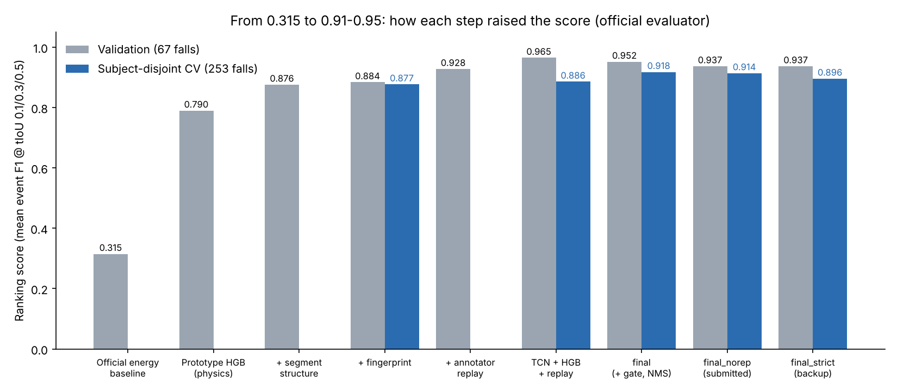
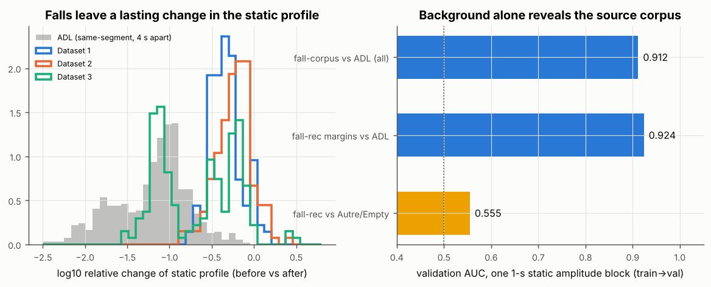
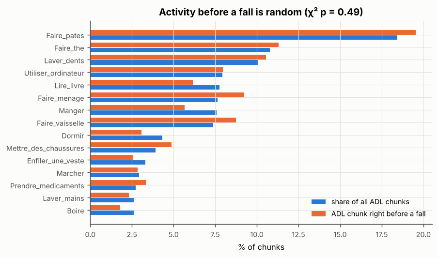
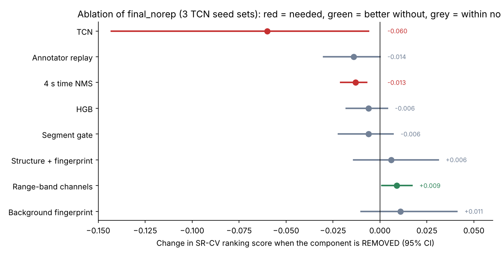

# UWB-FallTrack Challenge (ABC 2027): A to Z

Status as of 2026-10-17: the submission system `final_norep` scores **0.937 on validation and 0.914 on subject-disjoint
cross-validation**, against **0.315** for the official baseline. The code package is built and tested. Rounds 3 and 4 and
their fresh-seed confirmations found no change worth making, so the system is frozen for the test data (Oct 20).



---

## 1. Problem statement

- **Task:** detect every **fall** in long, continuous radar streams and give its **start and end time**.
- **Sensors:** 3 impulse-radio UWB radars (XeThru X4M200). Each frame has 368 values per radar, at 50 Hz.
- **Output:** one CSV row per detected fall: `stream_id, t_start, t_end, score, t_alarm`.
- **Data rules:** only the challenge package may be used; the original LIARA recordings are forbidden. Each test
  stream must be processed on its own.
- **Organisers:** UQAC (Bouchard lab, LIARA) with Sozo Inoue's lab (Kyutech), at the ABC 2027 conference.

## 2. Metric, rules and timeline

- **Ranking score:** mean event F1 at temporal IoU (tIoU) 0.1, 0.3 and 0.5. Flagged (low-quality) falls are ignored.
- **Tie-breaks:**
  1. smaller median start error;
  2. fewer false alarms per hour.
- **Results can be submitted once.** Every team submits its code.
- **Paper:** 8–12 pages, IJABC; it must cite the dataset, LOPDO and challenge summary papers. One member presents at the
  workshop. Prize: 100,000 JPY.

| Milestone (23:59 AoE) | Date |
| --- | --- |
| Test data sent | Oct 20, 2026 |
| Registration closes | Oct 27, 2026 |
| **Results due (one submission)** | **Nov 3, 2026** |
| Paper due | Nov 10, 2026 |
| Camera-ready | Dec 8, 2026 |
| Conference (Sydney, hybrid) | Jan 19–22, 2027 |

## 3. The dataset

| | Train | Val |
| --- | --- | --- |
| Streams | 13 (6.18 h) | 5 (2.05 h) |
| Annotated falls | 359 | 119 |
| Evaluable falls (not flagged) | 186 | 67 |
| By mat position (D1 / D2 / D3) | 89 / 81 / 16 | 33 / 34 / 0 |

The streams are **not continuous recordings**:
- Fall clips and daily-activity (ADL) clips are cut out of separate recordings.
- They are shuffled and joined with a **0.2 s crossfade**.
- "Other activity" and empty-room recordings are inserted whole (77–120 s).


## 4. Data analysis: what we found

Every finding below was checked twice, independently, with code; findings that did not reproduce were corrected or
dropped.

### 4.1 Frame format

The 368 values are **184 complex range bins: I = 0–183, Q = 184–367**. Three checks agree:
- the range-time maps break at bin 184;
- the motion profiles of the two halves correlate at r ≈ 0.87–0.92;
- the LIARA paper gives 184 bins at 5.14 cm.

The official baselines treat them as 368 real numbers.

### 4.2 Fall timing

- A fall starts a median **3.0 s after its junction** (range 0–7.9 s) and lasts a median **1.74 s**.
- The person then lies still for 3–10 s until the next junction.
- There are about **58 falls per hour**. 35 of the 478 falls last exactly 2.00 s.


### 4.3 Splice junctions dominate the baseline's errors

At every join, a slow background filter (the baseline's 3 s EMA) spikes about **55×** the ADL level.
- **90% of the baseline's false alarms start within 1 s of a junction.**
- Junctions themselves are easy to detect (AUC 0.98–0.99).


### 4.4 The true fall signature

- Frame-difference energy peaks **inside the fall** for 87–90% of falls, at 500–1500× the ADL level.
- The **static profile before vs after** a fall separates falls from ADL with AUC about 0.98 (D1) and 0.99 (D2).
- **Each mat position is seen mainly by one radar:**
  - D1 by R29444 and D2 by R30722, at range bins about 5–21;
  - D3 by R29171, at bins about 40–64.


### 4.5 Background fingerprint, repeated frames, generated labels

- **Background fingerprint.** Fall and ADL recordings were made in different sessions, so one second of static
  background separates them (AUC 0.94–0.98).
- **Repeated frames.** 23–27% of frames are exact repeats of the previous frame (sample-and-hold), so the real radar
  rate is about 37 Hz.
- **Reused ADL content.** 97% of val ADL frames appear in more than one stream. We never used this, because it would
  mean cross-stream matching.
- **Labels are generated.** The package's own `annotate.propose_fall` produces the labels; re-running it gives start/end
  within 0.02/0.04 s. Dataset 3 is almost entirely flagged, so the score depends on D1 and D2.



### 4.6 Where the data differs from the description

| Topic | Website / README | What the data shows |
| --- | --- | --- |
| Frame layout | "368 values" | 184 complex bins, I then Q |
| Frame rate | 50 Hz | About 25% exact repeats; real rate about 37 Hz |
| Stream structure | Long monitoring streams | Shuffled 8–20 s clips with 0.2 s crossfades; 24 hard cuts, all into fall clips |
| Activity context | Falls in daily life | The neighbouring activity is random (shuffled) |
| Dataset 3 | One of three mat positions | 87% of train and 100% of val D3 falls are flagged and ignored |
| Labels | Fall start and end | Placed by an algorithm on the static-profile change, not on the motion peak |

## 5. Which activities come before a fall?

**None in particular.** The activity right before a fall matches each activity's overall share (chi-square p = 0.49),
because the generator shuffles the clips.
- Of 474 falls with a clip before them, 389 follow an ADL clip, 82 follow another fall and 3 follow an
  "other activity" or empty-room clip.
- Cooking pasta, making tea and brushing teeth come first only because they are the most common clips.



## 6. How we worked

1. **Analysis:** an in-depth dataset analysis plus a first prototype, which proved the patterns.
2. **Independent review and experiments:**
   - re-checked every analysis finding with separate code;
   - reviewed the plan against the literature and the rules;
   - ran experiments E1–E5 (pseudo-test bank, boundaries, I/Q features, deep model, ensembles).
3. **Round 2:**
   - built the subject-disjoint CV (SR-CV) and the promotion rule;
   - improved the system;
   - shipped the `uwbfall` package.
4. **Rule compliance:** after the organisers' answers we built the `final_norep` and `final_strict` variants.
5. **Round 3 + ablation:**
   - 4 parallel experiments, each re-verified independently from its output files;
   - an ablation run on our GPU.
6. **Round 4:** 9 TCN seeds and Chute04 segment features, confirmed on fresh seed sets on our GPU.

**Promotion rule** (a change is kept only if all three hold):
- paired subject-cluster bootstrap P(gain) ≥ 0.90;
- at least 3 of 4 folds improve;
- val does not drop by more than 0.02.

## 7. What we tried (experiment log)

| # | Idea | Result | Kept? |
| --- | --- | --- | --- |
| 1 | Official baselines (energy, logistic) | Val 0.315 / 0.258 | Reference |
| 2 | Gradient boosting on physics features | Val 0.790 | Yes |
| 3 | + segment structure (junction timing) | Val 0.876 | Yes |
| 4 | + background fingerprint | Val 0.884 | Yes |
| 5 | Pseudo-test bank (50 regenerated streams) | 0.877 ± 0.020 | Became the CV |
| 6 | Re-run the package annotator on each detection | Val 0.884 → 0.928; start error 0.22 → 0.06 s | Yes |
| 7 | Complex I/Q (phase) features | Not confirmed on val | No |
| 8 | Dilated TCN (3 seeds), blend 0.75 TCN + 0.25 HGB | Val 0.930 / 0.934 | Yes |
| 9 | Ensemble voting (per-radar models, model committee, stacking, box fusion) | No gain over a simple average | No |
| 10 | Blend + annotator replay | Val 0.965; CV 0.886 | Yes |
| 11 | Replay agreement gate 0.1 → 0.3 | CV +0.008, P 1.00 | Yes |
| 12 | Segment-classifier gate + 4 s NMS | CV +0.028, P 1.00; FPs 35.7 → 20.0 | Yes |
| 13 | One event per segment; 3-class post-fall model | P 0.06–0.31 | No |
| 14 | Crop clustering, boundary selector, containment fallback | ≤ 0 | No |
| 15 | Dataset-3 zone features; zero weight on ignored falls | −0.011 to −0.008 | No |
| 16 | Hit-probability model and threshold | +0.009, P 0.886 | No |
| 17 | Cross-stream ADL duplicate mask | Breaks the rules | Never used |
| 18 | Rule-safe variants | −0.004 / −0.023 | Options |
| 19 | R3: recover missed falls in likely fall clips | +0.0003 | No |
| 20 | R3: replay/detector boundary blend | +0.006 on two independent seed groups, but only 2/4 folds on fresh seeds | No (optional setting) |
| 21 | R3: TriDet-style learned boundary head | Worse than replay | No |
| 22 | R3: image verifier, ImageNet ResNet-18 on range-time images | +0.013 but 1/4 folds | No |
| 23 | R3: ActionFormer-style TAL member | Not finished | - |
| 24 | Ablation: remove the 48 range-band channels | +0.009 first, then −0.011 on fresh seeds (noise) | No |
| 25 | R4: 9 TCN seeds instead of 3 | +0.006, P 0.87 | No |
| 26 | R4: Chute04 segment features (6 extra segment-classifier features) | +0.005, P 0.91 on 3 seed sets; +0.002, P 0.84, 2/4 folds on 6 | No |

## 8. The final system

It processes one raw stream into fall rows in under a minute on a CPU, using only open-source libraries
(scikit-learn, LightGBM, PyTorch).

1. **Features** every 0.2 s, 112 channels:
   - 64 physics/structure features: motion and frame-difference energy, static-profile change, junction timing,
     segment statistics, fingerprint;
   - 48 range-band energies.
2. **Two detectors:** gradient boosting (HGB) and a dilated temporal CNN (3 seeds). Fall probability =
   0.75 × TCN + 0.25 × HGB.
3. **Segment gate:** a LightGBM classifier rates each junction-to-junction segment; score =
   p × (0.7 + 0.3 × P(fall segment)).
4. **Decoding:** threshold, smoothing, minimum duration and gap, all tuned on training out-of-fold predictions only.
5. **Boundaries:** the package annotator re-run on 6 crops around each detection; median of agreeing crops
   (tIoU ≥ 0.3); 1.0 s minimum.
6. **Clean-up:** a 4 s time NMS, then the official validator. Drift monitors warn if the test data looks different.

## 9. Results

### 9.1 Scores

| System | Val | Subject-disjoint CV | Note |
| --- | --- | --- | --- |
| Official baseline | 0.315 | – | |
| `final` | 0.952 | 0.918 | uses a rule grey zone |
| **`final_norep`** | **0.937** | **0.914** | **submission** |
| `final_strict` | 0.937 | 0.896 | backup if dedup is not allowed |

### 9.2 Training vs validation (`final_norep`)

| Data | Ranking F1 | F1 @0.1 / 0.3 / 0.5 / 0.7 | TP / FP / FN @0.3 | Precision | Recall |
| --- | --- | --- | --- | --- | --- |
| Training (13 streams, out-of-fold) | 0.941 | 0.965 / 0.959 / 0.899 / 0.774 | 176 / 5 / 10 | 97.2% | 94.6% |
| Validation (5 streams) | 0.937 | 0.962 / 0.947 / 0.902 / 0.782 | 63 / 3 / 4 | 95.5% | 94.0% |
| Final model (18 streams, out-of-fold) | 0.941 | 0.966 / 0.958 / 0.898 / 0.778 | 240 / 8 / 13 | 96.8% | 94.9% |
| Subject-disjoint CV (test-like) | 0.914 | 0.940 / 0.928 / 0.874 / 0.715 | 239 / 23 / 14 | 91.2% | 94.5% |

- Training and validation are almost equal, so there is no overfitting.
- The CV uses unseen subjects, like the test, so we expect a test score of about **0.90–0.91**.
- Median start error is 0.04–0.05 s; false alarms are 1–1.5 per hour.
- Plain accuracy is not meaningful here: more than 97% of the time contains no fall.

### 9.3 Metrics we computed

- **Official:**
  - ranking F1;
  - F1 at tIoU 0.1 / 0.3 / 0.5 / 0.7;
  - TP / FP / FN;
  - median start error;
  - false alarms per hour;
  - latency.
- **Decision metrics:**
  - paired subject-cluster bootstrap P(gain) and 95% CI;
  - folds improved;
  - TCN seed spread;
  - error anatomy;
  - per-fall-type hit rate.
- **Analysis metrics:**
  - AUCs (junctions 0.98–0.99, static change 0.98/0.99, fingerprint 0.94–0.98);
  - chi-square p = 0.49;
  - I/Q correlation r = 0.87–0.92.
- **Safety metrics:**
  - drift monitors (events/h, junctions/h, PSI);
  - sha256 reproducibility;
  - runtime and memory.

## 10. Ablation (3 TCN seed sets, team GPU)

| Removed | SR-CV | Change [95% CI] | Reading |
| --- | --- | --- | --- |
| (none: final_norep) | 0.908 | – | |
| TCN | 0.847 | −0.060 [−0.143, −0.006] | essential |
| Annotator replay | 0.894 | −0.014 [−0.030, +0.000] | essential; start error 0.04 → 0.32 s |
| 4 s time NMS | 0.895 | −0.013 [−0.021, −0.007] | essential |
| HGB | 0.901 | −0.006 [−0.018, +0.004] | helps a little |
| Segment gate | 0.902 | −0.006 [−0.022, +0.007] | helps a little |
| Structure + fingerprint | 0.914 | +0.006 [−0.014, +0.031] | neutral |
| **Range-band channels** | **0.917** | **+0.009 [+0.001, +0.017]** | **better without** |
| Background fingerprint | 0.919 | +0.011 [−0.010, +0.041] | neutral (2/4 folds) |



## 11. Round 3: new ideas, each re-checked independently

| Idea | Result | Rule |
| --- | --- | --- |
| Recover missed falls | +0.0003. 8 of 14 misses already have a row, in the wrong place | Fail |
| **Boundary blend (replay + detector)** | **+0.006 over 3 seed sets, P 0.99**; start error 0.04 → 0.19 s | **Pass** |
| TriDet-style learned boundary head | Worse than re-running the package annotator | Fail |
| Image verifier (open-source ResNet-18, "multi-modal" view) | +0.013, but only in 1 of 4 folds | Fail |
| ActionFormer/TriDet-style TAL member | Stopped by a usage limit | - |

The boundary blend is now an optional `uwbfall` setting, `boundary.det_blend`. It reproduces the experiment byte for
byte, and the shipped configs and models are unchanged.

**Confirmation on fresh TCN seeds** (`make confirm DEVICE=cuda`, seed sets never used for selection):

| Variant | SR-CV | Delta [95% CI] | P(gain) | Folds improved | Passes |
| --- | --- | --- | --- | --- | --- |
| final_norep (submitted) | 0.9150 | - | - | - | - |
| no range bands | 0.9039 | −0.0112 [−0.0403, +0.0100] | 0.23 | 2/4 | no |
| boundary blend | 0.9212 | +0.0062 [−0.0000, +0.0126] | 0.97 | 2/4 | no |
| both | 0.9075 | −0.0076 [−0.0382, +0.0159] | 0.33 | 2/4 | no |

**Decision: no change; `final_norep` stays the submission.**
- The band result was seed noise.
- The blend is consistently slightly positive, but it fails the fold rule and worsens the start-error tie-break.

## 11b. Round 4: 9 TCN seeds and Chute04 segment features

Both ideas came from the round-3 error analysis. Falls from a chair (Chute04) are missed most often, because their
motion burst and static change are weaker, so 6 extra segment-classifier features target them.

| Variant | Seed sets | SR-CV | Delta [95% CI] | P(gain) | Folds improved | Passes |
| --- | --- | --- | --- | --- | --- | --- |
| 9 TCN seeds | 6–8 | 0.9140 vs 0.9080 | +0.0060 [−0.0040, +0.0176] | 0.87 | 3/4 | no |
| Chute04 features | 6–8 | 0.9132 vs 0.9080 | +0.0052 [−0.0016, +0.0144] | 0.91 | 3/4 | yes (at the margin) |
| both | 6–8 | 0.9127 vs 0.9080 | +0.0047 [−0.0060, +0.0166] | 0.79 | 3/4 | no |
| **Chute04 features** | **3–8 pooled** | **0.9138 vs 0.9115** | **+0.0024 [−0.0016, +0.0077]** | **0.84** | **2/4** | **no** |

**Decision: no change; `final_norep` stays the submission.** The Chute04 pass on seed sets 6–8 did not hold on seed
sets 3–5, so it was mostly noise. Its CPU refit (`final_norep_x`) scores 0.944 on val against 0.937, within val noise.

## 12. Problems we hit and how we solved them

| Problem | Fix |
| --- | --- |
| Baseline false alarms at every junction | Motion from frame differences; junctions used as features |
| Labels follow the static change, not motion | Re-run the package annotator; start error 0.22 → 0.06 s |
| Train CV looked better than reality (reused ADL, subjects) | Subject-disjoint CV from regenerated streams |
| Single-seed "wins" flipped | Every candidate compared over 3 TCN seeds |
| Short streams crashed prediction | Streams under 5 s get no rows, covered by a test |
| `boundary.dedup` setting was ignored | Bug fixed, variants re-run |
| CUDA torch install failed on the RTX 5060 Ti | torch 2.11 + CUDA 12.8 pinned in `run_all.sh` |
| GPU models not bit-identical | Submission runs on CPU with the shipped model |
| Re-tuned compliance models failed the sha256 check | Replaced with clean CPU retrains (byte-identical predictions) |
| A failed prediction could leave an old CSV | Old outputs deleted; pipeline stops on any error |
| Re-tuning a 9-seed model lost seeds 5–8 | `retune` now copies every TCN seed file |

## 13. Rule compliance

| Variant | Repeat-statistic features | Drops repeated frames before the annotator | CV | Val |
| --- | --- | --- | --- | --- |
| `final` | Yes | Yes | 0.918 | 0.952 |
| **`final_norep`** | No | Yes (asked) | 0.914 | 0.937 |
| `final_strict` | No | No | 0.896 | 0.937 |

These hold in every variant:
- each test stream is processed on its own;
- no cross-stream or repeated-content matching;
- only package data;
- no LIARA recordings;
- only open-source libraries.

## 14. Questions to the organisers and answers

| # | Question | Answer | What we did |
| --- | --- | --- | --- |
| Q1 | Same generator and settings for test? | Yes; only the seed and participants differ | Kept the CV as the test proxy |
| Q2 | May we use repeated content? | No matching within or across streams or with train/val; process each stream on its own | Cross-stream mask off; built `final_norep` and `final_strict` |
| – | Submissions and code | Results once; code from every team | One variant for both CSV and code |
| Q3 | Within one stream, may we drop a frame identical to the previous frame of the same radar? | **Waiting** (Ma'am → challenge chair, written answer requested) | Allowed → `final_norep`; not allowed or no answer → `final_strict` |

## 15. Submission plan

```bash
git pull
make predict-test VARIANT=final_norep TEST_DIR=/path/to/streams/test   # CPU; or final_strict
make package VARIANT=final_norep                                       # same variant
```

- `predict-test` checks the model's sha256, predicts each stream, runs the official validator and the drift monitors.
- `package` builds `dist/uwbfall_<variant>_code.zip`: code, model, fallback, run scripts, exact library versions,
  a README for the organisers and hashes, plus the CSV.
- Tested: a fresh unzip reproduces the dry-run CSV byte for byte.

Checklist:

- [ ] Confirm team registration before Oct 27
- [ ] Get the written answer to Q3 and pick the variant
- [x] Run `make confirm DEVICE=cuda` and decide on the round-3 changes (no change)
- [x] Round 4 confirmation, `SUITE=r4` and `SUITE=r4x` (no change)
- [ ] Download the test streams (Oct 20) into a folder named `test`
- [ ] `make predict-test`: `SUBMISSION CHECK: OK`, 0–1 drift alerts
- [ ] `make package` and test the zip once from a fresh folder
- [ ] Submit the CSV and the code zip by Nov 3
- [ ] Write the paper by Nov 10

## 16. Related work

- **LIARA dataset papers:** all classify pre-cut clips and none localise falls in time.
  - Maitre et al., IEEE JBHI 2021: CNN-LSTM.
  - Imbeault-Nepton et al., ACM GoodIT 2023: CNN vs RF.
  - Abudalfa & Bouchard, Transp. Res. Procedia 2025 and Applied Intelligence 2025: transfer learning, ViT + ResNet.
- **Temporal action localisation on sensors** is the closest method family:
  - Bock et al., IMWUT 2024 (ActionFormer/TriDet on IMU);
  - XRF V2, IMWUT 2025 (WiFi + IMU);
  - WiFiTAD, AAAI 2025.
- We found no published radar fall *localisation* result with event F1 at tIoU. Our 0.91–0.95 is at or above what
  related work reports.

## 17. Where everything is

- **Repository:** `noushadbackup/challenge1` (private).
- **Reports:**
  - `reports/REPORT.md` (analysis), `reports/PLAN.md`, `reports/team/` (data team);
  - `reports/round2/` (FINAL, EVAL, AUDIT), `reports/round3/` (R3, ABLATION), `reports/round4/R4.md`;
  - `reports/COMPLIANCE.md`, `reports/CHALLENGE_INFO.md`.
- **Runbooks:** `SUBMISSION.md` (release day), `LOCAL_GPU.md` (running on the PC).
- **Code and models:** `uwbfall/` (pipeline), `models/` (shipped models with sha256), `dist/` (code packages).
