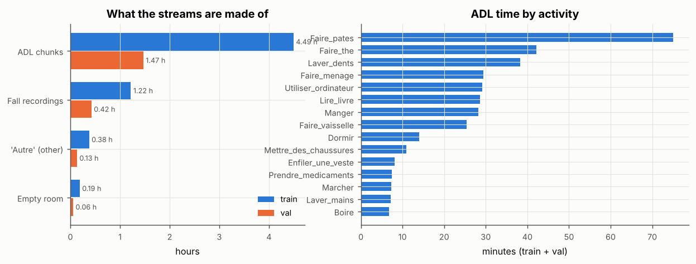
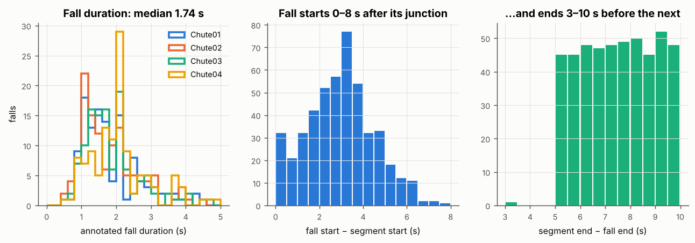
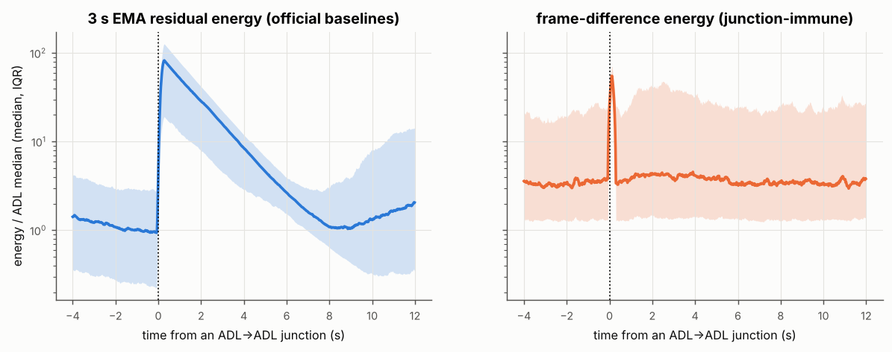
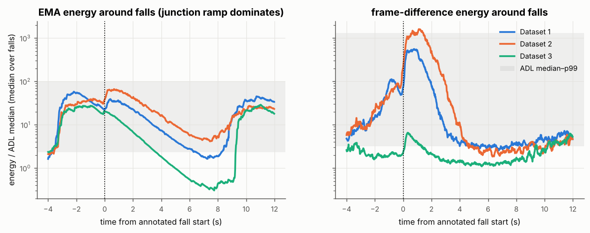
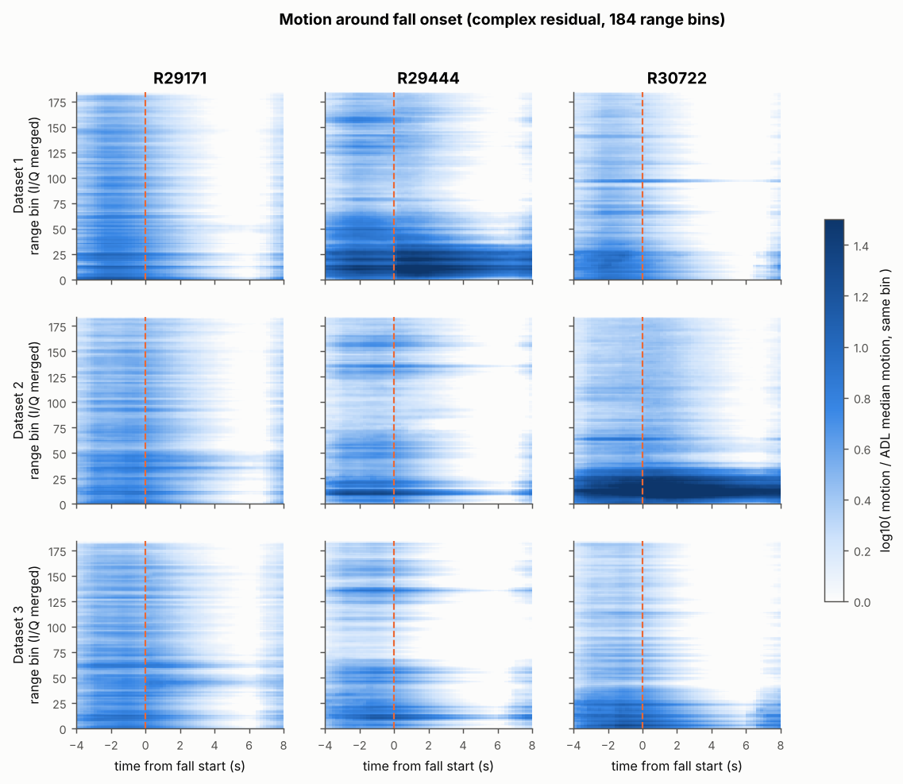
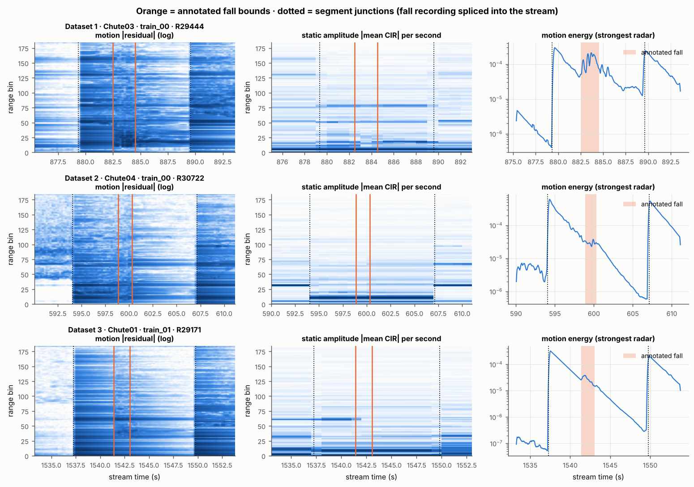
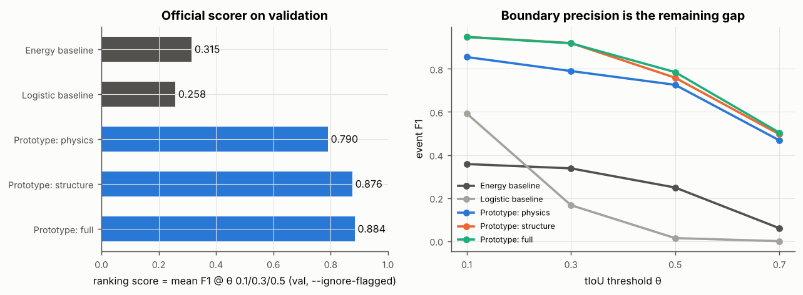

# ABC 2027 UWB Fall Challenge — In-depth dataset analysis

Package analysed: `abc2027_uwb_train_v1.zip` (8.17 GB, 13 train + 5 val streams, 478 annotated falls).
Every number below is reproducible with the scripts in `analysis/` (see *Reproduce* at the end);
headline numbers are also in `reports/numbers.json`.

> **Corrections after the team review** (`reports/team/DATA_TEAM_VERDICT.md`): the EMA junction spike is ~55×, not 84×.
> "Motion peak before onset" was itself an EMA artefact; junction-immune motion peaks inside 87–90 % of D1/D2 falls.
> Dataset 3 is seen by R29171 at bins ~40–68. The fingerprint AUC vs ADL is 0.94–0.98. Current best val system: **0.965**
> (see `reports/PLAN.md` v2).

> **সংক্ষেপে (বাংলা):** ডেটাটা আসলে "সত্যিকারের একটানা রেকর্ডিং" নয় — fall রেকর্ডিং আর ADL রেকর্ডিং
> কেটে জোড়া লাগানো। এই জোড়া (junction), প্রতিটা corpus-এর আলাদা background, আর fall-এর পরে
> static profile-এর স্থায়ী পরিবর্তন — এই তিনটা pattern সবচেয়ে শক্তিশালী। এগুলো ব্যবহার করে একটা সাধারণ
> gradient-boosting prototype official scorer-এ validation-এ **0.884** পেয়েছে (official baseline 0.315)।
> বাকি দুর্বলতা হলো fall-এর শুরু/শেষ সীমানা নিখুঁতভাবে ধরা (θ = 0.7-এ F1 মাত্র 0.50)।

---

## 1. What the data actually is

| | train | val |
|---|---|---|
| streams | 13 (6.18 h) | 5 (2.05 h) |
| annotated falls | 359 | 119 |
| **evaluable** falls (`--ignore-flagged`) | 186 (D1 89, D2 81, D3 16) | **67** (D1 33, D2 34, D3 0) |
| ADL chunks / fall recordings / "Autre" / "Empty" (hours) | 4.49 / 1.22 / 0.38 / 0.19 | 1.47 / 0.42 / 0.13 / 0.06 |



* Streams are **synthetic concatenations** (`scripts/build_streams.py`): ADL recordings are cut
  into 8–20 s chunks; each fall recording is cropped around its fall; "Autre" (other activity in
  the fall room) and "Empty" room recordings are inserted whole (77–120 s). Everything is
  shuffled and joined with a 0.2 s crossfade.
* Fall density ≈ **58 falls/hour** (one every ~60 s; min gap 7.4 s; 82 fall→fall back-to-back joins).
* **Dataset = mat position.** Datasets 1/2/3 are the three fixed mat locations. Subjects are
  `Test_P{dataset}_{subject}`; train/val/test use disjoint subjects.
* **Dataset 3 is almost entirely flagged** (`quality=low` or `needs_review`: 87 % train,
  100 % val). Flagged falls become **ignore zones** on the official test: they neither count as
  hits nor misses, and an unmatched prediction touching one (±2 s) is dropped (no false-alarm penalty).
  ⇒ The score is decided almost entirely by **Dataset 1 and 2** falls.

### Frame format: 368 = 184 range bins × (I, Q)
The README only says "368 values". Three independent checks show a frame is **184 complex range
bins, I (0–183) followed by Q (184–367)**:
1. the range-time maps show a hard break at bin 184 (two copies of the same structure);
2. during falls, the motion-variance profile of bins 0–183 correlates **r ≈ 0.87–0.92** with
   bins 184–367 on the active radars;
3. the LIARA paper (Abudalfa & Bouchard, 2025) describes "184 real values recorded at each time
   instance" with 5.14 cm resolution (184 × 5.14 cm ≈ 9.5 m).

Use `z = x[..., :184] + 1j * x[..., 184:]` — amplitude, phase and phase-differences become
available. The official baselines treat the 368 values as one real vector.

## 2. Timing structure of a fall (strong priors)



| quantity | median | range |
|---|---|---|
| fall duration | 1.74 s | 0.48–5.0 s (Chute04 longest, 2.0 s) |
| fall start − its segment start | 3.0 s | 0–7.9 s |
| segment end − fall end | 7.6 s | 3.3–10 s |
| fall-recording segment length | 12.4 s | 7.3–18.6 s |
| ADL chunk length | 11.8 s | 0.5–20 s |
| Autre / Empty segment length | 118 s | 77–120 s |

The configured pre-margin is 3–8 s, but it is clipped to what the source recording contains,
so in practice the fall usually starts **≈3 s after a junction**, and the person then lies still
for 3–10 s until the next junction.

Fall types (from the LIARA papers): four categories — backward, forward, sideways and falling while
trying to sit on a chair. The mapping to `Chute01–04` is not documented; Chute04 being the longest
is consistent with the chair fall.

## 3. Pattern A — splice junctions dominate the "motion" signal



The baselines remove the background with a 3 s causal EMA. At **every junction** the static
background jumps, so the EMA residual energy spikes **~84× the ADL median** and decays
exponentially for ~8 s. The frame-difference energy only blips for the 0.2 s crossfade.

* **90 % of the energy baseline's false alarms start within 1 s of a junction**, and half of them
  lie inside fall recordings but outside the fall (the junction into a fall clip, or pre-fall walking).
* Junctions are themselves detectable: a 1-s static-profile jump detector separates junction
  blocks from others with **AUC 0.97** (recall 0.82 at precision 0.83, ±1.5 s).

## 4. Pattern B — the true fall signature





* With junction-immune frame-difference energy, D1/D2 falls peak **0–2 s after onset at
  ~500–1500× ADL median**; then the person lies still and motion falls *below* ADL level.
* **Each mat position is seen mainly by one radar:** D1 → R29444 (×51 at bin 10), D2 → R30722
  (×108 at bin 13), D3 → weak everywhere (≤ ×13). The mats are close to those radars (low bins ≈
  < 1 m), so range bin + radar id localise the mat.
* The annotation is not placed on the motion peak: the per-segment motion maximum lies inside
  the fall interval for only 11 % (D1) / 35 % (D2) of falls (median 1.5 s *before* onset — walking
  onto the mat). The organisers placed bounds on the **change of the static CIR profile**.
* **Static change is the best physical cue:** comparing the static amplitude profile 1–2 s
  before vs. after the fall gives AUC **0.976 (D1), 0.983 (D2), 0.76 (D3)** against ADL pairs 4 s apart.


## 5. Pattern C — the background fingerprints the source corpus

Fall recordings and ADL recordings were captured in different sessions, so their static
background differs. A gradient-boosting model on **one 1-second static amplitude block**
(trained on train streams, tested on val subjects):

| task | val AUC |
|---|---|
| fall-corpus block vs ADL block | 0.91 |
| fall-recording *margins* (outside the fall) vs ADL | 0.92 |
| fall recording vs Autre/Empty (same corpus) | 0.56 (≈ chance) |

The README confirms this ("pre-fall margin vs ADL AUC 1.000"). Consequence: **ADL chunks are easy
negatives; the hard negatives are Autre/Empty and the non-fall part of fall recordings.** Autre/Empty
are trivially recognisable by their length (77–120 s vs ≤ 18.6 s).

## 6. Your question: in which activities do falls happen?


In this dataset, **no activity "leads" to a fall.** The ADL chunk right before a fall follows the
overall ADL share exactly (χ² p = 0.49), because the generator shuffles segments, and the ADL and
fall corpora were recorded by different people in different places. A context model ("falls
happen after cooking") would only learn noise. Activities that produce false alarms for the
energy baseline are the movement-heavy ones (Faire_menage, Faire_the, Faire_pates, Faire_vaisselle),
but mostly because they sit next to junctions.

## 7. Verification: a prototype detector using these patterns

`analysis/prototype_detector.py`: 0.2 s blocks → HistGradientBoosting → smoothing/threshold → events.
Post-processing is tuned **only on out-of-fold train predictions** (leave-streams-out), then applied
once to validation and scored with the **official evaluator** (`--ignore-flagged`).



| detector | val ranking F1 | F1 @0.1/0.3/0.5/0.7 | TP/FP/FN @0.3 | FA/h | median start err |
|---|---|---|---|---|---|
| energy baseline (official) | 0.315 | .358/.338/.249/.060 | 34/100/33 | 48.8 | 0.32 s |
| logistic baseline (official) | 0.258 | .593/.167/.014/.000 | – | – | – |
| physics only (static change + frame-diff motion) | 0.790 | .855/.790/.726/.468 | 49/8/18 | 3.9 | 0.24 s |
| + segment structure (junction timing) | 0.876 | .949/.920/.759/.496 | 63/7/4 | 3.4 | 0.34 s |
| + background fingerprint | **0.884** | .948/.919/.785/.504 | 62/6/5 | 2.9 | 0.22 s |

Caveat: validation has only 67 evaluable falls, so ±0.04 is within noise. **Detection is nearly
solved (θ = 0.1–0.3 ≈ 0.95); the ranking is now decided by boundary precision (θ = 0.5).**

## 8. Implications for the solution

1. Never use a long-memory background (EMA ≥ 1 s) as the motion feature without resetting it at
   detected junctions; use frame differences or a junction-aware background.
2. Model the stream as **segments**: detect junctions → characterise each segment (length,
   fingerprint, static change) → localise the fall inside fall-like segments.
3. Work in **complex I/Q**: amplitude, phase velocity (micro-Doppler) per range bin, per radar.
4. Optimise for **D1/D2**; D3 predictions are free (ignored), so don't let D3 drive design.
5. Spend the effort on **boundary regression** (start/end offsets), because θ = 0.5 is in the ranking.
6. The package's `segments/` directory and generator allow **re-generating unlimited extra
   training streams with new seeds** (allowed: they ship in the package; only external LIARA
   copies are prohibited) — keep train and val subjects separate when doing so.

## Reproduce

```bash
pip install numpy scipy pandas scikit-learn matplotlib h5py
python analysis/extract_features.py <package_root> <feat_dir> 3   # ~2 min, 625 MB
ABC_ROOT=<package_root> ABC_FEATS=<feat_dir> python analysis/prototype_detector.py
ABC_ROOT=<package_root> ABC_FEATS=<feat_dir> python analysis/make_figures.py
```

## Sources
* Challenge site: https://sites.google.com/view/abc2027-uwbfalltrack-challenge/the-challenge
* Abudalfa & Bouchard, *Transfer Learning using Computer Vision Models for Fall Detection from UWB Radars*, Transp. Res. Procedia 84, 2025 — preprint https://easychair.org/publications/preprint/hK22
* Maitre, Bouchard & Gaboury, *Fall Detection With UWB Radars and CNN-LSTM Architecture*, IEEE JBHI 25(4), 2021 — https://constellation.uqac.ca/6269/
* Imbeault-Nepton et al., *Fall Detection from UWB Radars: A Comparative Analysis…*, ACM GoodIT 2023 — https://doi.org/10.1145/3582515.3609535
* Abudalfa & Bouchard, *A Hybrid ViT and ResNet Model for Fall Detection Using UWB Radars*, Applied Intelligence 55, 2025 — https://doi.org/10.1007/s10489-024-06156-9
